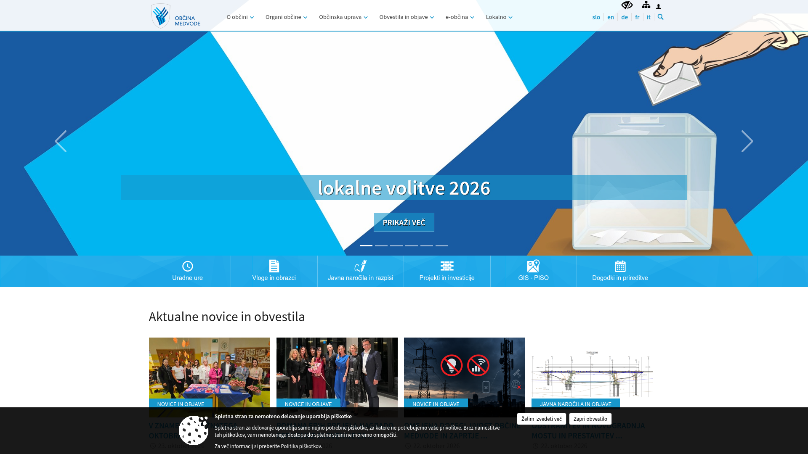

# DESIGN.md: Občina Medvode

## Source
- URL: https://medvode.si/
- Capture date: 24 October 2026
- Evidence: Firecrawl `branding` + `images`, homepage screenshot
- Target stack: React + Vite + plain CSS

## Reference Screenshot

## Design Summary
The municipal website uses a professional light interface led by a strong institutional blue, a brighter cyan accent, and pale blue supporting surfaces. The prototype should adopt this palette while retaining its existing application layout and interactions.

## Design Tokens

### Colors
- Primary institutional blue: **#266AAB** — navigation, primary actions, key data panels, selected states.
- Accent cyan: **#1797CB** — gradients, links, focus states, secondary emphasis.
- Secondary light blue: **#74C1E0** — highlights, decorative accents, light-on-dark details.
- Background: **#FFFFFF**.
- Link blue: **#1797CB**.
- Text: near-black on the source; the prototype may retain its more readable blue-neutral text scale.
- Derived navy and pale-blue tints are **inferred** from the observed palette for sidebar, borders, hover states, and elevated surfaces.
- Orange/red remain distinct for warnings; green remains available for success confirmations.

### Typography
- Observed source fonts: Source Sans Pro for body and Oswald for headings.
- This color-only iteration keeps the prototype's existing DM Sans + Manrope pairing.

### Spacing And Layout
- Observed source base spacing unit: 4 px; source border radius: 10 px.
- Preserve the prototype's current spacing, density, 7–14 px radii, and responsive application shell.

## Components
- Sidebar and hero/metric panels: institutional blue with cyan accents.
- Primary buttons and active controls: #266AAB; hover states use a darker derived blue.
- Links, focus rings, selected tabs, and progress indicators: #1797CB or #266AAB.
- Cards and panels: white; supporting surfaces use inferred pale blue-gray tints.
- Status badges: blue for active/informational states, amber for attention, green for success.

## Page Patterns
No structural changes. Apply the palette consistently to the applicant and administrator dashboards, all three dashboard variants, tables, forms, modals, scoring, and the guided application flow.

## Content Style
No content changes. Keep the Slovenian interface and existing microcopy.

## Agent Build Instructions
1. Use #266AAB as the main brand color rather than introducing an unrelated blue.
2. Use #1797CB and #74C1E0 as accents, not as replacements for readable body text.
3. Convert green-tinted neutral surfaces to blue-tinted neutrals while preserving contrast.
4. Preserve semantic warning and success colors so workflow state remains easy to scan.
5. Do not change layout, application behavior, or data in this iteration.

## Rerun Inputs
workflow: firecrawl-website-design-clone
source_url: https://medvode.si/
target_stack: React + Vite + plain CSS
output: DESIGN.md and prototype color implementation
